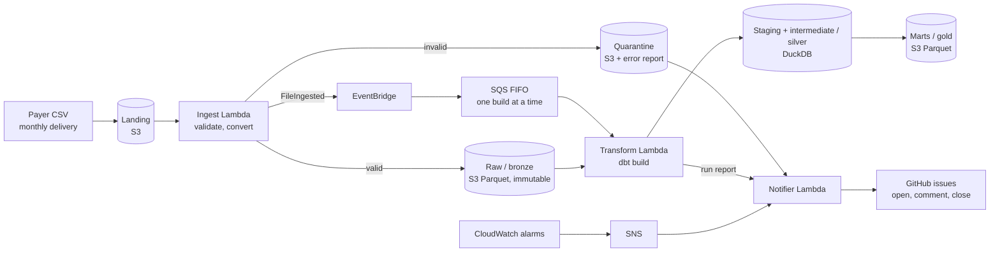

# Claims Lakehouse: S3 + Lambda + dbt-duckdb

[](https://github.com/fredr171/claims-lakehouse-dbt-duckdb/actions/workflows/ci.yml)

An event-driven ETL pipeline on AWS for monthly healthcare claims deliveries from two payers:
CMS CCLF (Medicare fee-for-service) and Humana Medicare Advantage. A file dropped in S3 is
validated, stored immutably as Parquet, modeled with dbt into member history and netted
claims, and published as payer-agnostic marts. Every failure becomes a GitHub issue that
closes itself when the data recovers.

All data is **synthetic**, from my seeded generator repo
[synthetic-payer-files](https://github.com/fredr171/synthetic-payer-files), which also writes
**answer keys**: the exact results a correct pipeline must produce. The tests check the
pipeline against them.

**Stack:** Python 3.13, AWS (S3, Lambda, EventBridge, SQS FIFO, SNS, CloudWatch, SSM),
Terraform, dbt Core + DuckDB, pyarrow, pytest (moto, responses), ruff.

## Architecture



| Layer | Where | What it holds |
|---|---|---|
| Landing | S3 | CSVs exactly as delivered |
| Raw (bronze) | S3, Parquet | Every delivery, all columns as text, plus lineage columns |
| Staging (silver) | DuckDB views | Typed, renamed, current deliveries only |
| Intermediate (silver) | DuckDB incremental tables | Member history (SCD2), claim families with net paid |
| Marts (gold) | S3, Parquet | Payer-agnostic members, claims, member months, PMPM |

## Key decisions, layer by layer

### 1. Ingestion (landing → raw): validate files, not rows
- **File-level checks only:** name, size, encoding, strict CSV parsing, exact header, field
  counts, non-empty keys. A file that fails is quarantined (with an error report) and the run
  continues. Row-level quality belongs in dbt, where a bad value doesn't reject a whole delivery.
- **Everything is read as text.** Claims codes carry leading zeros (FIPS `05`, ICD-10, NPIs);
  type inference would silently corrupt them. Typing happens in staging.
- **Idempotent and reconciled:** a SHA-256 manifest per file skips duplicates; Parquet row
  counts must match the CSV before anything is published.
- **Config-driven:** a new file type is one YAML file; a new payer is one prefix plus the YAML.

### 2. Raw (bronze): immutable, keyed by delivery
- Each delivery gets its own key: `<feed>/<file_type>/delivery_month=<m>/checksum=<sha256>/`.
  A corrected re-send lands **next to** the bad file instead of overwriting it, so you can
  always answer "what did the payer send, and when", and roll back a bad correction.
- Partitions follow the delivery (from the file name), never claim dates: late claims and
  adjustments of earlier months are dbt's job, not a reason to split files.
- Versioning plus a 90-day lifecycle rule are the safety net for human mistakes.

### 3. Staging (silver): one clean view per file, no business logic
- Rename to readable names shared across payers (`beneficiary_mbi`, `claim_start_date`),
  empty string → NULL, cast types. Codes and IDs stay text.
- A deliveries index picks the **current** delivery of each file (the latest one ingested);
  staging reads only those.
- **Stop vs warn tests.** A *stop* test (keys, identity, claim linkage, netting amounts)
  means the data would make intermediate wrong, so dbt skips everything downstream and
  intermediate keeps its last good state. A *warn* test flags odd data that is still safe.
  An amount rule escalates from warn to stop when more than 1% of a month's lines break it
  (a broken extract, not a few odd lines).

### 4. Intermediate (silver): correct state from out-of-order deltas
- **Member history (SCD type 2)** from change-only files: a new version when a hash of the
  tracked attributes changes; change type (new, update, termination) is derived, not trusted
  from the file.
- **Claim families:** an original plus its later reversals or replacements, which can arrive
  months later. Status comes from which versions are still active, never from file order.
- **Incremental by affected keys**, not append-only or a date watermark: every row records
  which raw files built it; each run recomputes only the keys touched by new or superseded
  files. Delivery order doesn't matter, and an incremental run equals a full rebuild.

### 5. Marts (gold): payers plug in, the marts never change
- **Payer registry:** one list in `dbt_project.yml` is the only place the marts learn about
  payers. Each payer supplies two **conformed** views (coverage spans and claim families)
  under an enforced dbt contract: same columns and types for every payer, with payer codes
  (sex `1`/`2` vs `M`/`F`, `CANCELLED` vs `VOIDED`) mapped there, never in the marts.
- **Five marts**, unioned from the conformed views: `dim_payer`, `dim_member` (one row per
  person across payers, keyed by MBI, so an FFS → Medicare Advantage switcher is one member),
  `fct_claims`, `fct_member_months` and `agg_payer_monthly` (PMPM). No names or addresses.
- **Lifecycle without SQL changes:** *onboard* = conformed views + a registry entry;
  *retire* = set `retired_month` (history stays, members stop counting as current, late files
  warn); *offboard* = remove the entry (the payer drops out of every mart).
- **Payer isolation:** the runner builds one feed per dbt pass, so a stop in one payer never
  freezes another payer's gold.

### 6. Orchestration and alerting: event-driven, one build at a time
- Each ingested file publishes an event; a FIFO queue serializes builds of the **whole feed**
  (so a bad file of one type keeps blocking even when a clean file of another type arrives).
- Build outcomes: passed, warned, stopped (state published, bad feed held back) or error (old
  state kept, retried with a 2/5/10-minute backoff, then a dead-letter queue).
- DuckDB state lives in S3 with an ETag-conditional upload, so two writers can't overwrite
  each other.
- **GitHub issues instead of email:** quarantines, stopped builds and five CloudWatch
  alarms each open one issue, add comments while the problem persists, and close it on
  recovery (e.g. [#11](https://github.com/fredr171/claims-lakehouse-dbt-duckdb/issues/11): a
  stopped build, closed by the next passing run). The repo is public, so issues carry only
  identifiers and counts, never data values.

## Testing

250 pytest tests run with no AWS or GitHub access (moto and responses mock them):

- **Every ingestion check** against deliberately broken fixture files (BOM, ragged rows, bad
  encoding, missing keys, ...).
- **End to end against the answer keys:** generate 36 months for both payers, ingest them with
  the real code, run dbt, and match current members, member changes, claim actions and net
  paid exactly. Loading the months in uneven batches, or re-sending old months, must give the
  same tables as a full rebuild.
- **Marts against the answer keys:** net paid by service month for both payers, the 17 payer
  switchers (coverage spans and current payer), and member months in the last month.
- **Gating:** corrupted deliveries prove that stops block intermediate (and keep blocking later
  months), a re-send recovers it, warns don't block, a stop in one payer still refreshes the
  other payer's marts, and retiring, offboarding and onboarding a payer work by registry alone.
- Every new dbt test was first shown to **fail on broken data** before it was trusted.

## Found in live runs

Things the live pipeline exposed, each fixed and covered by a test:

- EventBridge → SQS FIFO silently dropped events until content-based deduplication was on.
- dbt crashed in Lambda (no `/dev/shm` for multiprocessing locks); dbt now starts with threading
  locks, and a test simulates Lambda's environment.
- Landing 2023-07 before 2023-06 stopped the Humana build on a member change test until the
  missing month arrived, then caught up cleanly (issue
  [#11](https://github.com/fredr171/claims-lakehouse-dbt-duckdb/issues/11) opened and closed itself).
- A bad eligibility file and its re-send drove the switch to immutable bronze, and showed
  that an alert must be keyed by the feed the *failing test* reads, not every feed the run built.

## Run it

```bash
python -m venv .venv
.venv/Scripts/python -m pip install -e ".[dev,dbt]"   # also installs the pinned generator
.venv/Scripts/python -m pytest                        # all tests, offline (~30 min)
.venv/Scripts/python -m pytest -m "not dbt"           # fast tests (~1 min)
cd dbt && ../.venv/Scripts/dbt build                  # build against S3 (AWS CLI profile)
```

Infrastructure is Terraform in [`infra/terraform/`](infra/terraform/). For every check,
model, AWS resource and CLI, see [docs/pipeline-details.md](docs/pipeline-details.md).

## Adapting it for an enterprise

This project is built for one engineer, two payers and synthetic data. With real PHI, dozens
of payers and a team, the platform underneath would change, but the design decisions would not.

**What carries over unchanged:** immutable bronze keyed by delivery, file-level validation with
quarantine, stop vs warn gating, incremental builds by affected keys, the payer registry with
its conformed contract, and answer-key tests. These are the hard parts to add later, which is
why they came first.

| Area | Today | At enterprise scale | Why |
|---|---|---|---|
| Accounts and access | One AWS account, one IAM admin user | AWS Organizations with separate dev, test and prod accounts; SSO via IAM Identity Center; no long-lived keys | Smaller blast radius; every prod access is tied to a named person |
| Infrastructure | Terraform with local state | Remote state in S3 with locking, reusable modules per environment, `terraform plan` on every PR | Several people apply changes, so state must be shared and locked |
| CI/CD | GitHub Actions: ruff and the fast tests on every PR; dbt end-to-end tests run locally | GitHub Actions with OIDC to AWS: the full test suite, dbt slim CI (`state:modified+`) against a prod clone, promotion from dev to prod | Every change is tested the same way before it reaches prod |
| Compliance | Synthetic data, SSE-S3 | HIPAA: AWS BAA, KMS customer-managed keys, CloudTrail data events, VPC endpoints, Macie on landing, retention set by policy (years, not 90 days) | Real claims are PHI |
| PII | Names and addresses kept in staging only, by convention | Column-level access (Lake Formation or warehouse masking policies): only approved roles see names, addresses and birth dates | Minimum-necessary access, enforced by the platform |
| File intake | Files uploaded to S3 by hand | AWS Transfer Family (SFTP) per payer, a delivery calendar, and an alert when an expected file is late | Payers push files, and a missing file is an incident too |
| Ingestion compute | Lambda (15 min, 10 GB limits) | Lambda for small files, ECS Fargate or Glue for large ones, running the same `process_file` | Some payer files are tens of GB |
| Storage and compute | Parquet plus one DuckDB file in S3, one build at a time | Apache Iceberg tables queried by Snowflake, Databricks or Athena; the dbt models move by switching adapters | Many concurrent readers and writers, time travel, schema evolution |
| Orchestration | EventBridge → SQS FIFO → Lambda | Airflow, Dagster or Step Functions: payers build in parallel, with backfills and reruns from a UI | Dozens of feeds; operators rerun a feed without a deploy |
| Alerting | GitHub issues | PagerDuty for stops and errors, Jira or ServiceNow for quarantines (only the notifier's client changes), an SLA per payer | On-call rotation and existing ticket workflows |
| Data quality | dbt tests | Plus volume and distribution anomaly checks (e.g. Elementary), with test results kept as history | Catches a file that is valid but wrong, such as half the usual rows |
| Discovery | dbt docs and this README | A data catalog with lineage (DataHub or OpenMetadata), model owners via CODEOWNERS, a dbt semantic layer for PMPM | Analysts can find and trust data without asking the builder |
| Team structure | One dbt project | dbt Mesh: a project per domain (intake, members, claims) exposing contracted public models | Teams ship independently; the payer contract already works this way |
| Mart design | Shaped by the answer keys and my own definitions (a member month = covered any day; PMPM = net paid by service month) | Requirements, metric definitions and sign-off from actuarial and finance, an owner per mart, definition changes by change request | Member months and PMPM are business definitions; changing one restates history |

## License

Released under the [MIT License](LICENSE).
